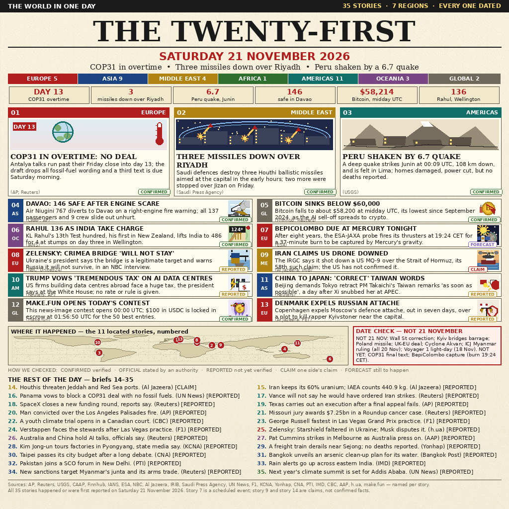

# THE TWENTY-FIRST — Saturday 21 November 2026

[](https://make.fun/bounty/news-image-20261121)
[](https://make.fun/bounty/news-image-20261121)
[](https://make.fun/bounty/news-image-20261121)

One image summing up Saturday 21 November 2026's world news, for the
[make.fun bounty "Sum up 21 November's world news in one image"](https://make.fun/bounty/news-image-20261121).



## What it is

A cream-paper newspaper front page, **THE TWENTY-FIRST**, with exactly 35
stories across 7 regions — every one verified as having happened, or first
been reported, on Saturday 21 November 2026:

- **3 heroes:** COP31 in overtime in Antalya (day 13, no deal); three
  Houthi missiles shot down over Riyadh; Peru's 6.7 quake in Junin.
- **10 drawn features (04–13):** the Air Niugini 767's safe emergency
  landing in Davao (146 aboard); Bitcoin below $60,000; KL Rahul's 136 in
  Wellington; BepiColombo's Mercury arrival burn at 19:24 CET; Zelensky
  on the Crimea bridge; Iran's claim of a downed US drone over Hormuz;
  Trump's "tremendous tax" on AI data centres abroad; China telling
  Japan to "correct" its Taiwan words; **make.fun opening this very
  contest at 00:00 UTC, $100 USDC escrowed at 01:56:50 UTC**; Denmark
  expelling Russia's defence attache.
- **22 briefs (14–35)** across Europe, the Americas, Africa, the Middle
  East, Asia and Oceania.
- **Region strip** (Europe 5, Asia 9, Middle East 4, Africa 1, Americas
  11, Oceania 3, Global 2 — sums to 35), a 6-number stat strip, a
  numbered world map for the 11 located stories, and a red **DATE CHECK**
  box naming the 20-November items that are *not* today's news (Wall
  Street correction, Kyiv bridges barrage, Poland missile, UK–EU deal,
  Cyclone Akvan, ICJ Myanmar ruling, Voyager 1 light-day) plus what had
  not yet happened at press time (any COP31 final deal, BepiColombo's
  orbit capture).
- Every story carries its source in parentheses, including all 22 briefs,
  and **every story carries an uncertainty label** — CONFIRMED, OFFICIAL,
  REPORTED, CLAIM or FORECAST — explained in the HOW WE CHECKED legend.
  Story 7 (BepiColombo) is a scheduled event; stories 9 and 14 are
  claims, not confirmed facts.

All 13 illustrations are code-drawn vector-style charts, maps and
diagrams — no photos. Body text is 11–12 px. The image is 421,451 bytes
(1024×1024 RGB), drawn deterministically: two runs are byte-identical.

## Files

- `entry.png` — the image (1024×1024 RGB, 421,451 bytes)
- `generate.py` — the Pillow program that draws it (deterministic)
- `main.py` — the entrypoint: copies `entry.png` to
  `$MAKEFUN_OUTPUT_DIR/entry.png` (stdlib only)
- `transcript.txt` — one line per story with its sources, plus the
  excluded 20-November items
- `README.md`, `LICENSE` (MIT)

## Reproduce

```sh
python3 generate.py   # redraws entry.png, byte-identical every run
mkdir -p out && MAKEFUN_OUTPUT_DIR=out python3 main.py
```

## License

MIT — see [LICENSE](LICENSE).
